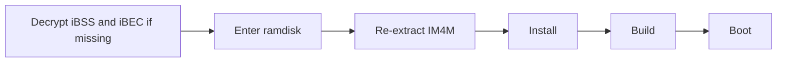

<div align="center">

# n56-patcher

**Build and install tool for running other iOS versions on iPhone 6 Plus (N56AP / iPhone7,1)**

[简体中文](README.md) · English · [繁體中文](README.zh-TW.md) · [日本語](README.ja.md)


-5E5CE6?style=flat-square)
-5E5CE6?style=flat-square)
-5E5CE6?style=flat-square)


[Quick start](#quick-start) · [iOS 14.8](#ios-148) · [iOS 15.8.8](#ios-1588) · [Features](#features) · [Advanced usage](#advanced-usage) · [Author](#author) · [Support the project](#support-the-project)

</div>

---

By default, the tool rebuilds the KC from a clean J96 kernel and also generates iBSS, iBEC, DeviceTree and TrustCache, for five boot images in total. Kernel and DeviceTree transforms call `patches/<version>/impl/` in this repository directly, and firmware inputs live in the local `donors/` directory.

The project has been run end to end. The final boot bundle includes the hardware adaptation, DataB decryption and checkra1n. Technical conclusions are in [docs/conclusions/13.md](docs/conclusions/13.md) (Chinese). Touch ID is connected through the iOS 12 SEP transport bridge.

iOS 14.8 boots and is jailbroken, with all hardware and system features working. See [iOS 14.8](#ios-148). iOS 15.8.8 also boots and is jailbroken (palera1n rootless), with all hardware and system features working. See [iOS 15.8.8](#ios-1588).

> [!WARNING]
> This tool creates volumes and writes system files on your device, so back up first. This project is not affiliated with Apple. It is provided as is, and you use it at your own risk.

## Quick start

### 1. Set up the environment

On macOS with full Xcode installed (the iPhoneOS SDK is required):

```sh
python3 -m pip install -r requirements.txt
python3 tools/setup.py
```

`tools/setup.py` generates `donors/` (the checkra1n userland plus fsck and apfs.fs from the apfsios14 tool set) and builds gaster from source. The first build needs the device in DFU to decrypt iBSS and iBEC.

**Linux is supported too**: `tools/setup.py` builds `apfs-fuse` for read-only rootfs mounting and `ldid` for a local `codesign` shim — no Apple `xcrun`, `hdiutil`, or iPhoneOS SDK required. Use a clean Python environment, e.g. `sudo -H env -u PYTHONPATH -u PYTHONHOME PYTHONDONTWRITEBYTECODE=1 /usr/bin/python3 n56patcher.py ...`, and always pass an existing `--workdir`. On Linux, `rootfs-finalize` retries only the finalize stage.

If downloading checkra1n fails with `CERTIFICATE_VERIFY_FAILED`, the python.org build of Python has no root certificates installed: the script falls back to the system CA bundle or `curl`. You can also run `Install Certificates.command` from the Python folder, or download the 0.12.4 DMG manually and run `CHECKRA1N_DMG=/path/checkra1n.dmg python3 tools/setup.py`.

Generate the SSH ramdisk once while the device is in DFU (requires internet access):

```sh
cd tools/SSHRD_Script && ./sshrd.sh 12.5.8
```

### 2. Download the IPSWs

Download these files from Apple, keep the file names unchanged, and put them in `ipsw/`:

```text
ipsw/iPhone_5.5_12.5.8_16H88_Restore.ipsw          # N56, used by tools/extract_ipsw.py
ipsw/iPhone_5.5_13.7_17H35_Restore.ipsw            # N66
ipsw/iPad_64bit_TouchID_13.7_17H35_Restore.ipsw    # J96
```

The first time a rootfs is needed, the flow extracts the DMG to `ipsw/cache/` and reuses it afterwards.

### 3. Run the end-to-end flow

On first run or after a restore, put the device in DFU, then run the end-to-end flow or choose “端到端” (end to end) in the web UI:

```sh
sudo python3 n56patcher.py all
# Local web UI; stages that write to disk need sudo:
sudo python3 gui.py
```



> [!IMPORTANT]
> - A restore invalidates the old IM4M and old boot bundles. `build` only checks that `state/IM4M.bin` exists, not whether it is stale, so run `extract-im4m` before building on its own.
> - Each web UI stage uses its own `build/` directory, so when you run stages separately `boot` does not reuse the output of `build`. Use “端到端” (end to end) for a fresh install.
> - `--dry-run` only prints the flow. It does not access or write to the device and does not produce build output.
> - The web UI supports 简体中文, English, 繁體中文 and 日本語, switchable in the top bar. Console logs come from the CLI and stay in Chinese.

### Local directories

These directories are ignored by Git:

| Directory | Contents |
| --- | --- |
| `ipsw/` | IPSWs you downloaded; the build generates the kernel, DeviceTree, TC, Wi-Fi firmware and Health libraries into `ipsw/cache/derived/` |
| `donors/` | Firmware inputs generated by `tools/setup.py` |
| `state/` | IM4M; iOS 13 with `--data-protection none` also needs a self-supplied `state/keybags.tar`. The default `encrypted` and iOS 14 do not |
| `build/` | Build output |

## iOS 14.8

The `n56-ios14` target uses the J96 14.8 kernel and system image plus N66 14.8 drivers and iPhone resources. It installs to separate System14 / Data14 volumes, and Data14 is encrypted by default (`--data-protection none` turns encryption off). Also put these in `ipsw/`:

```text
ipsw/iPhone_5.5_14.8_18H17_Restore.ipsw            # N66
ipsw/iPad_64bit_TouchID_14.8_18H17_Restore.ipsw    # J96
```

After restoring iOS 12.5.8, put the device in DFU and run the command below once. It installs everything up to the current stage, including checkra1n, Cydia and USB SSH. In the web interface, choosing target `n56-ios14` and the End to end stage does the same:

```sh
sudo python3 n56patcher.py all --target n56-ios14
```

| Working |
| --- |
| Touch screen, display, Wi-Fi, Bluetooth, baseband, audio, vibration, sensors, camera, Health, activation and iCloud, jailbreak, Touch ID, NFC/Apple Pay, Apple Watch pairing, iCloud backup (needs encrypted Data) |

Touch ID (`touchid`) is enabled by default. The kernel includes an iOS 12 SEP transport bridge with initialization, enrollment and matching protocol conversion. The sensor must keep its factory pairing with the SEP: a device with a replaced sensor cannot enroll, the same as on native iOS 12.

Storage on the 16 GB model is tight. Read the storage section of [docs/conclusions/14.md](docs/conclusions/14.md) (Chinese) before installing. That document also covers the current status, first boot and technical details.

## iOS 15.8.8

The `n56-ios15` target uses the J96 15.8.8 kernel and system image plus N66 15.8.8 drivers and iPhone resources. It installs to separate System15 / Data15 volumes; Data15 is encrypted by default, and the jailbreak is palera1n rootless (rootful is optional). Also put these in `ipsw/`:

```text
ipsw/iPhone_5.5_15.8.8_19H422_Restore.ipsw           # N66
ipsw/iPad_64bit_TouchID_15.8.8_19H422_Restore.ipsw   # J96
```

First run `python3 -m patches.ios15.impl.rootfs.rootless_bootstrap` once to download the upstream jailbreak packages. After restoring iOS 12.5.8, put the device in DFU and run the command below once to install everything. In the web interface, choosing target `n56-ios15` and the End to end stage does the same:

```sh
sudo python3 n56patcher.py all --target n56-ios15
```

| Working |
| --- |
| Touch screen, display, Wi-Fi, Bluetooth, baseband, audio, vibration, charging, sensors, camera, Health, activation and iCloud, iCloud backup, NFC/Apple Pay, Apple Watch pairing, jailbreak (rootless/rootful, Sileo, SSH) |

The Touch ID transport bridge is connected; it cannot be verified on this unit because its sensor was replaced. Status and technical details are in [docs/conclusions/15.md](docs/conclusions/15.md) (Chinese).

## Features

All features are selected by default. `--features` selects patches across layers by feature, and `--patches` overrides the KC selection only. Dependencies are added automatically.

| Feature | KC patch ID | Pulls in |
| --- | --- | --- |
| `pmu` | `kc.pmu_d2186` | Base KC |
| `touch` | `kc.mt_n56` | PMU, Chestnut |
| `charging` | `kc.sn2400` | PMU |
| `chestnut` | `kc.chestnut_kext` | Base KC |
| `wifi` | `kc.wifi` | Base KC |
| `vibration` | `kc.vibration` | Base KC |
| `sep` | `kc.legacy_sep` | Base KC |
| `touchid` | `kc.touchid` | SEP (experimental, see below) |
| `audio` | `kc.audio` | Base KC |

## Advanced usage

<details>
<summary><b>Build and boot</b></summary>

```sh
python3 n56patcher.py build --workdir build/current
python3 n56patcher.py boot --workdir build/current
```

Build chain:

```text
Clean J96 KC → generic boot patches → D2207 PMU adaptation → SN2400 → Chestnut
             → N56 touch → Wi-Fi → DRV2604 → SEP compatibility → CS42L67
             → complzss + watchtower → boot_KC.img4
```

DeviceTree is rebuilt from the original N56 iOS 12 and N66 iOS 13 JSONC.

TrustCache starts from the full repair-v7 set, then adds the mrm generated on site, the final Health libraries, the Bluetooth/SEP services and the combined dyld cache cdhash.

The Health overlay first deploys all non-Mach-O resources of the 50 target bundles from N66 17H35, then overwrites them with the binaries fixed by repair-v7, which keeps the Core Data models, plists, assets and localizations complete.

The `ui` overlay deploys Health, Phone and Wallet from N66 17H35, overwrites every missing or differing iPhone Settings resource and settings bundle binary, and adds the boot logo, app icons and wallpapers. App bodies are only accepted from N66 iOS 13.7.

KC, iBSS and DeviceTree from a clean build are byte-identical to the on-device boot bundle. iBEC embeds the boot-args, which no longer include `serial=3` by default; override them with `--bootargs` when you need serial logs. TrustCache is paired with the rootfs written by the same build, so an installed device keeps using its own boot bundle. See the [technical conclusions](docs/conclusions/13.md#trustcache-配套) (Chinese).

</details>

<details>
<summary><b>Cherry-pick</b></summary>

```sh
# Show the actual patch list when selecting only Wi-Fi and audio
python3 n56patcher.py list --patches kc.wifi,kc.audio
# Build these two KC patches
python3 n56patcher.py build --patches kc.wifi,kc.audio --workdir build/wifi-audio
# Select touch by feature; PMU and Chestnut are pulled in automatically
python3 n56patcher.py build --features core,touch --workdir build/touch
# All default features minus audio
python3 n56patcher.py build --exclude kc.audio --workdir build/no-audio
```

`--patches` selects KC patches exactly, while rootfs still follows `--features`. `--patches ''` produces the base KC. In the GUI, tick the features you need and the execution order is arranged automatically.

</details>

<details>
<summary><b>Install another system step by step</b></summary>

The volume layout is `disk0s1s4` SystemB and `disk0s1s5` DataB.

```sh
python3 n56patcher.py ramdisk
python3 n56patcher.py extract-im4m
sudo python3 n56patcher.py install --workdir build/current
python3 n56patcher.py build --workdir build/current
python3 n56patcher.py boot --workdir build/current
```

DataB uses encrypted content protection by default, and the install flow creates the systembag automatically. Cydia is installed with the `checkra1n` feature and needs internet access to download. It finishes configuring itself about 30 seconds after first boot.

The install flow also corrects how `installd` handles an empty Application container set, so the first free-signed app can install.

Overlays are generated directly from SystemA and the N66/J96 rootfs. If the IPSWs are not in `ipsw/`, pass their paths explicitly:

```sh
sudo python3 n56patcher.py install \
  --n66-ipsw /path/to/iPhone_5.5_13.7_17H35_Restore.ipsw \
  --j96-ipsw /path/to/iPad_64bit_TouchID_13.7_17H35_Restore.ipsw
```

The current profile targets SystemA 16H88 and N66/J96 17H35. The flow checks the build, key file digests and the original bytes of every byte patch.

</details>

<details>
<summary><b>Source layout</b></summary>

- `targets/`: device, input paths and feature selection.
- `patches/<version>/kc/`, `patches/<version>/dt/`, `patches/<version>/rootfs/`: build and install steps.
- `patches/<version>/impl/`: source and ABI maps that actually modify the kernel, drivers and DeviceTree.
- `core/`: dependency ordering, path resolution, tool invocation, ramdisk and APFS.
- `tools/`: pinned upstream submodules plus setup and input import tools. See [UPSTREAM.md](tools/UPSTREAM.md).

</details>

## Author

**CelestialSayuki (Celestial紗雪)**, electronic engineering student at the University of Electronic Science and Technology of China (UESTC) and Apple developer.

| Platform | Account |
| --- | --- |
| GitHub | [@CelestialSayuki](https://github.com/CelestialSayuki) |
| X | [@CelestialSayuki](https://x.com/CelestialSayuki) |
| Telegram | [@CelestialSayuki](https://t.me/CelestialSayuki) |
| Bilibili | [Celestial紗雪](https://space.bilibili.com/514518697) |
| Email | [CelestialSayuki@qq.com](mailto:CelestialSayuki@qq.com) |
| Website | [infodrop.cn](https://infodrop.cn) |

## Support the project

If this project helped you, [tips are welcome](DONATE.md) 🥺

Honestly: getting newer iOS running bit by bit has used **over US$1,500 worth of AI token quota** so far… If it saved you some time, even the price of a coffee would mean a lot 🥺🙏

## License

This project is licensed under [GPL-3.0](LICENSE). `tools/checkra1n-kpf/` keeps the upstream PongoOS MIT license, as stated in its file headers, and submodules follow their own upstream licenses. The repository contains no Apple firmware, and IPSWs are not covered by this license.
