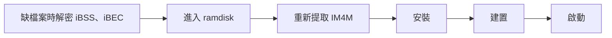

<div align="center">

# n56-patcher

**iPhone 6 Plus（N56AP / iPhone7,1）的其他系統建置與安裝工具**

[简体中文](README.md) · [English](README.en.md) · 繁體中文 · [日本語](README.ja.md)


-5E5CE6?style=flat-square)
-5E5CE6?style=flat-square)
-5E5CE6?style=flat-square)


[快速開始](#快速開始) · [iOS 14.8](#ios-148) · [iOS 15.8.8](#ios-1588) · [功能](#功能) · [進階用法](#進階用法) · [作者](#作者) · [支持專案](#支持專案)

</div>

---

預設從乾淨的 J96 核心重建 KC，同時產生 iBSS、iBEC、DeviceTree、TrustCache，共五個啟動映像。核心和裝置樹轉換直接呼叫本儲存庫的 `patches/<version>/impl/`，韌體輸入放在本機 `donors/`。

專案已從頭到尾跑通，最終啟動包包含硬體適配、DataB 解密和 checkra1n。技術結論見 [docs/conclusions/13.md](docs/conclusions/13.md)（簡體中文）。Touch ID 已接入 iOS 12 SEP 收發橋。

iOS 14.8 已能進系統並越獄，硬體與系統功能均已可用，見 [iOS 14.8](#ios-148)。iOS 15.8.8 同樣已能進系統並越獄（palera1n rootless），硬體與系統功能均已可用，見 [iOS 15.8.8](#ios-1588)。

> [!WARNING]
> 本工具會在裝置上建立磁碟區並寫入系統，操作前請自行備份。本專案與 Apple 無關，按現狀提供，風險由使用者自行承擔。

## 快速開始

### 1. 準備環境

在 macOS 安裝完整 Xcode（需要 iPhoneOS SDK）後：

```sh
python3 -m pip install -r requirements.txt
python3 tools/setup.py
```

`tools/setup.py` 會產生 `donors/`（checkra1n 使用者空間和 apfsios14 工具集的 fsck、apfs.fs）並從原始碼建置 gaster。首次建置需裝置處於 DFU，用於解密 iBSS、iBEC。

下載 checkra1n 若出現 `CERTIFICATE_VERIFY_FAILED`，是 python.org 版 Python 未安裝根憑證：指令碼會自動改用系統憑證或 `curl`；也可執行 Python 目錄下的 `Install Certificates.command`，或手動下載 0.12.4 DMG 後用 `CHECKRA1N_DMG=/path/checkra1n.dmg python3 tools/setup.py` 離線完成。

SSH ramdisk 需在 DFU 下產生一次（需連網）：

```sh
cd tools/SSHRD_Script && ./sshrd.sh 12.5.8
```

### 2. 下載 IPSW

從 Apple 下載以下檔案，檔名不變，放入 `ipsw/`：

```text
ipsw/iPhone_5.5_12.5.8_16H88_Restore.ipsw          # N56，供 tools/extract_ipsw.py 使用
ipsw/iPhone_5.5_13.7_17H35_Restore.ipsw            # N66
ipsw/iPad_64bit_TouchID_13.7_17H35_Restore.ipsw    # J96
```

首次需要 rootfs 時，流程會把 DMG 解壓到 `ipsw/cache/`，之後直接重複使用。

### 3. 執行端到端流程

首次執行或刷機後，讓裝置進入 DFU，再執行端到端流程，或在網頁介面選擇「端到端」：

```sh
sudo python3 n56patcher.py all
# 本機網頁介面，寫入磁碟的階段需要 sudo：
sudo python3 gui.py
```



> [!IMPORTANT]
> - 刷機後舊 IM4M 和舊啟動包都會失效。`build` 只檢查 `state/IM4M.bin` 是否存在，不判斷是否過期，單獨建置前要先執行 `extract-im4m`。
> - 網頁介面的每個階段使用獨立的 `build/` 目錄，分步執行時 `boot` 不會重複使用 `build` 的結果，全新安裝請用「端到端」。
> - `--dry-run` 只列印流程，不存取裝置，不寫入裝置，也不產生建置產物。
> - 網頁介面支援简体中文、English、繁體中文、日本語，在頂列切換；主控台日誌來自命令列，維持簡體中文。

### 本機目錄

以下目錄已加入 Git 忽略規則：

| 目錄 | 內容 |
| --- | --- |
| `ipsw/` | 自行下載的 IPSW；核心、裝置樹、TC、Wi-Fi 韌體和 Health 函式庫由建置自動產生到 `ipsw/cache/derived/` |
| `donors/` | `tools/setup.py` 產生的韌體輸入 |
| `state/` | IM4M；iOS 13 用 `--data-protection none` 時還需要自備 `state/keybags.tar`，預設的 `encrypted` 和 iOS 14 都不需要 |
| `build/` | 產生結果 |

## iOS 14.8

目標 `n56-ios14`：J96 14.8 核心與系統映像、N66 14.8 驅動和 iPhone 資源，裝在獨立的 System14 / Data14 磁碟區上，Data14 預設加密（`--data-protection none` 可改為不加密）。`ipsw/` 裡另外放：

```text
ipsw/iPhone_5.5_14.8_18H17_Restore.ipsw            # N66
ipsw/iPad_64bit_TouchID_14.8_18H17_Restore.ipsw    # J96
```

刷回 iOS 12.5.8 後，裝置進 DFU，執行一次即可裝到目前階段（含 checkra1n、Cydia 和 USB SSH），網頁介面裡選目標 `n56-ios14`、階段「端到端」效果相同：

```sh
sudo python3 n56patcher.py all --target n56-ios14
```

| 已可用 |
| --- |
| 觸控、顯示、Wi-Fi、藍牙、基頻、音訊、震動、感測器、相機、健康、啟用與 iCloud、越獄、Touch ID、NFC/Apple Pay、Apple Watch 配對、iCloud 備份（需加密 Data） |

Touch ID（功能 `touchid`）預設開啟，核心已接入 iOS 12 SEP 收發橋，包含初始化、錄入和比對的協定轉換。指紋模組需與 SEP 原廠配對，換過模組的機器和原生 iOS 12 一樣無法錄入。

16 GB 機型空間很緊，安裝前請先看 [docs/conclusions/14.md](docs/conclusions/14.md)（簡體中文）的「空間」一節。現狀、首次開機和技術細節都在這份文件裡。

## iOS 15.8.8

目標 `n56-ios15`：J96 15.8.8 核心與系統映像、N66 15.8.8 驅動和 iPhone 資源，裝在獨立的 System15 / Data15 磁碟區上，Data15 預設加密，越獄用 palera1n rootless（可選 rootful）。`ipsw/` 裡另外放：

```text
ipsw/iPhone_5.5_15.8.8_19H422_Restore.ipsw           # N66
ipsw/iPad_64bit_TouchID_15.8.8_19H422_Restore.ipsw   # J96
```

先執行一次 `python3 -m patches.ios15.impl.rootfs.rootless_bootstrap` 下載越獄用的上游套件。刷回 iOS 12.5.8 後，裝置進 DFU，執行一次即可裝完，網頁介面裡選目標 `n56-ios15`、階段「端到端」效果相同：

```sh
sudo python3 n56patcher.py all --target n56-ios15
```

| 已可用 |
| --- |
| 觸控、顯示、Wi-Fi、藍牙、基頻、音訊、震動、充電、感測器、相機、健康、啟用與 iCloud、iCloud 備份、NFC/Apple Pay、Apple Watch 配對、越獄（rootless/rootful、Sileo、SSH） |

Touch ID 收發橋已接入；本機感應器換過，無法驗證。現狀和技術細節見 [docs/conclusions/15.md](docs/conclusions/15.md)（簡體中文）。

## 功能

預設選擇全功能。`--features` 按功能選擇各層補丁，`--patches` 單獨覆蓋 KC 選擇；相依項目自動補齊。

| 功能 | KC patch ID | 自動帶入 |
| --- | --- | --- |
| `pmu` | `kc.pmu_d2186` | 基礎 KC |
| `touch` | `kc.mt_n56` | PMU、Chestnut |
| `charging` | `kc.sn2400` | PMU |
| `chestnut` | `kc.chestnut_kext` | 基礎 KC |
| `wifi` | `kc.wifi` | 基礎 KC |
| `vibration` | `kc.vibration` | 基礎 KC |
| `sep` | `kc.legacy_sep` | 基礎 KC |
| `touchid` | `kc.touchid` | SEP（實驗性，見下） |
| `audio` | `kc.audio` | 基礎 KC |

## 進階用法

<details>
<summary><b>建置與啟動</b></summary>

```sh
python3 n56patcher.py build --workdir build/current
python3 n56patcher.py boot --workdir build/current
```

建置鏈：

```text
乾淨 J96 KC → 通用啟動補丁 → D2207 PMU 適配 → SN2400 → Chestnut
            → N56 觸控 → Wi-Fi → DRV2604 → SEP 相容 → CS42L67
            → complzss + watchtower → boot_KC.img4
```

DeviceTree 從 N56 iOS 12 與 N66 iOS 13 原始 JSONC 重建。

TrustCache 以 repair-v7 完整集合為基底，加入現場產生的 mrm、最終 Health 函式庫、藍牙/SEP 服務和組合 dyld cache cdhash。

Health 覆蓋層先從 N66 17H35 部署 50 個目標 bundle 的全部非 Mach-O 資源，再覆蓋 repair-v7 修復後的二進位檔，確保 Core Data model、plist、素材和本地化檔案完整。

`ui` 覆蓋層從 N66 17H35 部署 Health、電話、Wallet，覆蓋所有缺失或內容不同的 iPhone Settings 資源與設定 bundle 二進位檔，並補齊啟動 Logo、App 圖示和桌布。App 本體只接受 N66 iOS 13.7 來源。

乾淨建置的 KC、iBSS、DeviceTree 與實機啟動包逐位元組一致；iBEC 內嵌 boot-args，預設已移除 `serial=3`。需要序列埠日誌時用 `--bootargs` 覆蓋。TrustCache 與同一次建置寫入的 rootfs 配套，已安裝裝置繼續使用自己的啟動包，見[技術結論](docs/conclusions/13.md#trustcache-配套)（簡體中文）。

</details>

<details>
<summary><b>Cherry-pick</b></summary>

```sh
# 查看只選 Wi-Fi、音訊時的實際補丁清單
python3 n56patcher.py list --patches kc.wifi,kc.audio
# 建置這兩項 KC 補丁
python3 n56patcher.py build --patches kc.wifi,kc.audio --workdir build/wifi-audio
# 按功能選擇觸控，自動帶入 PMU 和 Chestnut
python3 n56patcher.py build --features core,touch --workdir build/touch
# 預設全功能減去音訊
python3 n56patcher.py build --exclude kc.audio --workdir build/no-audio
```

`--patches` 精確選擇 KC，rootfs 繼續使用 `--features` 的選擇。`--patches ''` 產生基礎 KC。GUI 中直接勾選需要的功能，執行順序自動安排。

</details>

<details>
<summary><b>分步安裝</b></summary>

磁碟區配置為 `disk0s1s4` SystemB、`disk0s1s5` DataB。

```sh
python3 n56patcher.py ramdisk
python3 n56patcher.py extract-im4m
sudo python3 n56patcher.py install --workdir build/current
python3 n56patcher.py build --workdir build/current
python3 n56patcher.py boot --workdir build/current
```

預設 DataB 啟用加密內容保護，安裝流程會自動建立 systembag。Cydia 隨 `checkra1n` 功能安裝，需要連網下載，首次開機約 30 秒後自動完成設定。

安裝流程會修正 `installd` 對空 Application 容器集合的處理，使第一個免費簽名 App 可以完成安裝。

覆蓋層直接從 SystemA 與 N66/J96 rootfs 產生。IPSW 不在 `ipsw/` 時可明確傳入路徑：

```sh
sudo python3 n56patcher.py install \
  --n66-ipsw /path/to/iPhone_5.5_13.7_17H35_Restore.ipsw \
  --j96-ipsw /path/to/iPad_64bit_TouchID_13.7_17H35_Restore.ipsw
```

目前 profile 對應 SystemA 16H88、N66/J96 17H35。流程會檢查 build、關鍵檔案摘要和所有位元組補丁的原始內容。

</details>

<details>
<summary><b>原始碼位置</b></summary>

- `targets/`：裝置、輸入路徑、功能選擇。
- `patches/<version>/kc/`、`patches/<version>/dt/`、`patches/<version>/rootfs/`：建置與安裝步驟。
- `patches/<version>/impl/`：實際修改核心、驅動程式和裝置樹的原始碼與 ABI 對應。
- `core/`：相依排序、路徑解析、工具呼叫、ramdisk 和 APFS。
- `tools/`：固定版本的上游 submodule、初始化和輸入匯入工具，見 [UPSTREAM.md](tools/UPSTREAM.md)。

</details>

## 作者

**CelestialSayuki（Celestial紗雪）**，電子科技大學電子工程專業在讀，Apple 開發者。

| 平台 | 帳號 |
| --- | --- |
| GitHub | [@CelestialSayuki](https://github.com/CelestialSayuki) |
| X | [@CelestialSayuki](https://x.com/CelestialSayuki) |
| Telegram | [@CelestialSayuki](https://t.me/CelestialSayuki) |
| Bilibili | [Celestial紗雪](https://space.bilibili.com/514518697) |
| 電子郵件 | [CelestialSayuki@qq.com](mailto:CelestialSayuki@qq.com) |
| 個人首頁 | [infodrop.cn](https://infodrop.cn) |

## 支持專案

如果這個專案幫到了你，歡迎[贊助支持](DONATE.md) 🥺

說句心裡話：為了把新系統一點一點跑起來，這個專案到現在光 AI 就用掉了 **1500 多美元額度** 的 token……如果它幫你省了時間，請我喝杯奶茶也好，一塊兩塊都是莫大的鼓勵 🥺🙏

## 授權條款

本專案以 [GPL-3.0](LICENSE) 授權。`tools/checkra1n-kpf/` 保留上游 PongoOS 的 MIT 授權，見各檔案開頭；submodule 遵循各自上游的授權。儲存庫不包含 Apple 韌體，IPSW 不在本授權範圍內。
